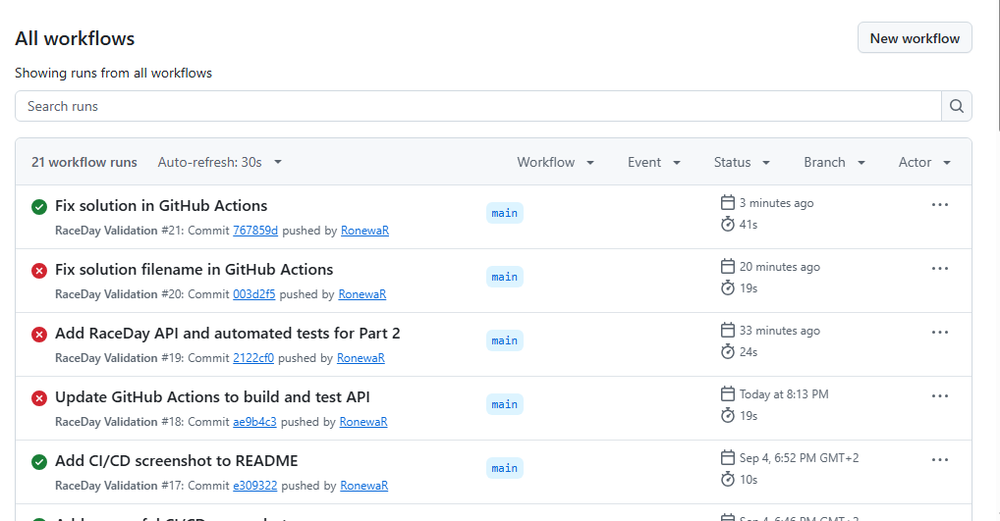
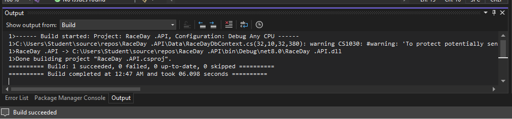

RaceDay Application

Project Overview
RaceDay is an application project designed to support race event management. The project includes database planning, API development, authentication, and automated testing.

Part 1: System Planning and Database Design

Part 1 focused on planning the RaceDay system and preparing the database design.

Deliverables include:
- RaceDay Entity Relationship Diagram (ERD)
- SQL database script
- API Endpoint Plan

Part 2: API Development and Testing

Part 2 extends the RaceDay project with a C# ASP.NET Core Web API.

Main Components
- RaceDay API project
- Authentication endpoints for user registration and login
- Database integration using Entity Framework Core
- JWT-based authentication configuration
- Automated API tests

Technologies Used
- C#
- ASP.NET Core Web API
- Entity Framework Core
- SQL Server
- Visual Studio 2022
- GitHub and GitHub Actions
- .NET 8

Automated Testing

The automated test project is `RaceDay.API.Tests`.

The tests were executed in Visual Studio 2022. The successful local test run reported six passing tests.

Continuous Integration and Continuous Delivery (CI/CD)

GitHub Actions is configured to validate the RaceDay repository automatically when changes are pushed or pull requests are created.

The workflow:
1. Checks for required assignment files.
2. Sets up .NET 8.
3. Restores project dependencies.
4. Builds the solution.
5. Runs automated tests.
6. Reports successful validation when all steps pass.

GitHub Actions Success Evidence

Successful CI/CD Build and Test Evidence

Repository Structure

- `.github/workflows/` — GitHub Actions workflow
- `RaceDay .API/` — API solution and source code
- `RaceDay.API.Tests/` — Automated test project
- `Raceday.sql` — Database script
- `Raceday erd.jpg` — Entity Relationship Diagram
- `API endpoint plan.pdf` — API planning document

Conclusion

The RaceDay project combines system planning, database design, API development, authentication, and automated testing. GitHub Actions provides automated validation to help ensure that changes can be built and tested consistently.